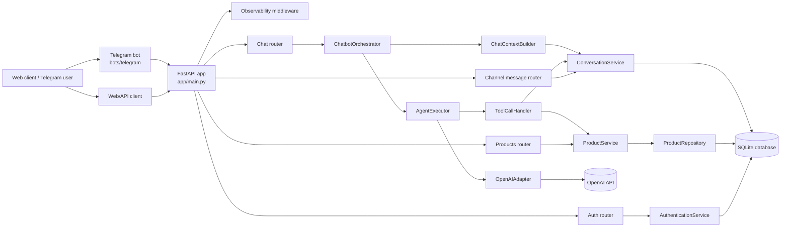
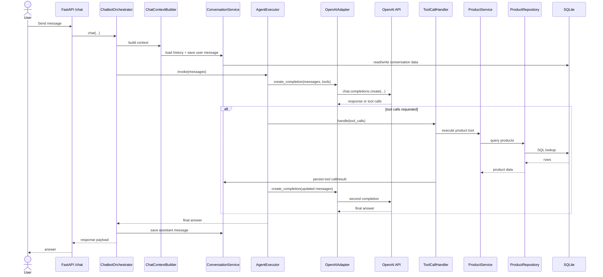

# Product RAG Chatbot

Product RAG Chatbot is an ongoing personal engineering project for a laptop-store assistant built with Python and FastAPI. The current system uses structured SQL retrieval plus an OpenAI-powered tool-calling agent to answer product questions about details, prices, stock, and search filters.

The longer-term goal is to evolve this codebase into a more complete retrieval system with BM25, vector search, hybrid retrieval, reranking, and evaluation. This repository should be read as a work in progress, not a finished production platform.

## Project Overview

This project aims to solve a common customer-service problem: answering product questions quickly while keeping responses grounded in current catalog data.

### Objectives

- Retrieve structured product facts from the database.
- Let an LLM decide when to answer directly or call product tools.
- Persist conversation history across turns.
- Support web/API usage and a Telegram-based entry point.
- Build toward a measurable RAG architecture over time.

### Current development status

The repository currently focuses on SQL-based product retrieval, authenticated chat flows, and agent tool calling. Semantic and hybrid retrieval are planned, not implemented.

## Project Status

### Implemented

- [x] FastAPI application with `/health`, `/auth/login`, `/chat`, `/products/*`, and `/channel-messages/delivery` routes.
- [x] JWT bearer authentication.
- [x] SQLite-backed product lookup, search, price, and stock retrieval.
- [x] Agent loop with OpenAI chat completions and tool calling.
- [x] Conversation persistence and conversation history retrieval.
- [x] Channel conversation/message mapping for web and Telegram flows.
- [x] Structured JSON logging and request correlation IDs.
- [x] Telegram polling bot that calls the API.
- [x] SQLite migrations and product seeding scripts.

### In Progress

- [ ] Scenario-based evaluation scaffolding under `evaluation/` is present, but the retrieval benchmark is not yet the final target architecture.
- [ ] Documentation and test harness cleanup as the codebase evolves.

### Planned

- [ ] BM25 keyword retrieval.
- [ ] Vector retrieval with Qdrant and BGE-M3.
- [ ] Hybrid retrieval with Reciprocal Rank Fusion.
- [ ] Reranking.
- [ ] Retrieval evaluation metrics and observability improvements.

## Key Features

- **Structured product retrieval** — Search by name, brand, processor, RAM, storage, price, stock, and other structured attributes.
- **Tool-calling agent** — The assistant can request product tools and continue the conversation with tool results.
- **Conversation memory** — Messages are persisted in SQLite and reused as context for follow-up questions.
- **Authentication** — Protected routes use bearer tokens issued by the login endpoint.
- **Telegram integration** — A separate Telegram bot process forwards messages to the API and records delivery mappings.
- **Structured logging** — Requests, agent steps, and tool execution are logged with correlation IDs.
- **Price normalization** — Product prices are converted to the configured target currency before being returned by the API.

## System Architecture

Current implementation overview:



## Agent Workflow

1. The user sends a message through the API or Telegram bot.
2. `ChatbotOrchestrator` builds the conversation context.
3. `ChatContextBuilder` loads prior messages and adds the system prompt.
4. `AgentExecutor` sends the messages to the OpenAI client.
5. The model either answers directly or returns tool calls.
6. `ToolCallHandler` executes the requested product tools.
7. Tool results are appended to the conversation history and persisted.
8. `AgentExecutor` sends the updated messages back to the model.
9. The model returns the final answer, which is saved as the assistant message.



## Technology Stack

| Category | Technologies actually used |
| --- | --- |
| Backend | Python, FastAPI, Pydantic, Uvicorn |
| AI and LLM | OpenAI Python SDK, chat completions, tool/function calling |
| Database | SQLite, SQL migrations, CSV seeding |
| Infrastructure | Structured JSON logging, daily rotating log files, `httpx`, `python-dotenv` |
| Testing | `pytest`, FastAPI `TestClient` |
| Integrations | OpenAI API, Telegram Bot API via `python-telegram-bot` |

## Project Structure

```text
product-rag-chatbot/
├── app/
│   ├── api/              # FastAPI routers and dependency wiring
│   ├── agents/           # Chat orchestration, tool handling, OpenAI adapter
│   ├── core/             # Config, constants, observability, exceptions
│   ├── database/         # SQLite connection, migrations, repositories
│   ├── models/           # Pydantic models for API/domain objects
│   ├── schemes/          # Request/response schemas
│   ├── services/         # Product, auth, conversation, and channel services
│   └── utils/            # Security helpers
├── bots/telegram/        # Standalone Telegram polling bot
├── data/                 # Product CSV and SQLite database file
├── evaluation/           # Scenario-based evaluation scripts and reports
├── scripts/              # Migration and seeding utilities
├── tests/                # Pytest suite
└── readme.md
```

### Important modules

- `app/main.py` — FastAPI app bootstrap and router registration.
- `app/api/routers/chat.py` — Chat endpoint and conversation-history endpoint.
- `app/agents/agent_executor.py` — Iterative tool-calling loop.
- `app/agents/chatbot_orchestrator.py` — Coordinates context building, agent execution, and persistence.
- `app/services/product_service.py` — Converts prices and wraps product repository calls.
- `app/database/repositories/product_repository.py` — Structured SQL search and stock aggregation.
- `bots/telegram/main.py` — Standalone Telegram polling entry point.

## Getting Started

### 1) Prerequisites

- Python 3.12 recommended.
- `pip`.
- An OpenAI API key.
- A SQLite-capable local environment.

### 2) Clone the repository

```bash
git clone <repository-url>
cd product-rag-chatbot
```

### 3) Create a virtual environment

```bash
python3 -m venv .venv
source .venv/bin/activate
```

### 4) Install dependencies

```bash
pip install -r requirements.txt
```

### 5) Configure environment variables

Create a `.env` file in the repository root.

There is no committed `.env.example` in this repo, so the variables below come from the source code.

### 6) Initialize the database

Create the schema and seed the product catalog:

```bash
python -m scripts.init_database
```

If you only want migrations, use:

```bash
python -m scripts.migrate
```

Default paths:

- Product CSV: `data/product.csv`
- SQLite database: `data/products.sqlite3`

### 7) Run the FastAPI application

```bash
uvicorn app.main:app --reload
```

### 8) Open Swagger/OpenAPI docs

- Swagger UI: `http://127.0.0.1:8000/docs`
- OpenAPI schema: `http://127.0.0.1:8000/openapi.json`

> Note: `/auth/login` expects a real user record in the `users` table. The repository includes auth tables, but I couldn't verify a built-in user-seeding command.

## Configuration

### Application settings

| Variable | Purpose | Required | Example |
| --- | --- | --- | --- |
| `OPENAI_API_KEY` | OpenAI API key used by the agent | Yes | `sk-...` |
| `OPENAI_MODEL` | Model name used for chat completions | No | `gpt-4.1-mini` |
| `DATABASE_PATH` | SQLite database path | No | `data/products.sqlite3` |
| `APP_NAME` | FastAPI application title | No | `Product RAG Chatbot` |
| `APP_VERSION` | Application version string | No | `0.1.0` |
| `APP_ENV` | Environment label | No | `development` |
| `LOG_LEVEL` | Logging level | No | `INFO` |
| `LOG_FILE` | Application log file path | No | `logs/app.log` |
| `JWT_SECRET_KEY` | JWT signing secret | Yes | `change-me-very-secret` |
| `JWT_ALGORITHM` | JWT algorithm | No | `HS256` |
| `ACCESS_TOKEN_EXPIRE_MINUTES` | Token lifetime | No | `30` |
| `DEV_USER_ID` | Default dev user ID | No | `dev-user-001` |
| `DEV_USERNAME` | Default dev username | No | `dev-user` |
| `DEV_PASSWORD_HASH` | Password hash for the dev user | Yes | `$argon2id$...` |
| `DEV_USER_ACTIVE` | Dev user active flag | No | `true` |
| `PRICE_SOURCE_CURRENCY` | Source currency label | No | `USD` |
| `PRICE_TARGET_CURRENCY` | Output currency label | No | `IDR` |
| `PRICE_CONVERSION_RATE` | Price conversion multiplier | No | `17987.0` |
| `CHAT_HISTORY_LIMIT` | Messages loaded into context | No | `12` |

### Telegram bot settings

| Variable | Purpose | Required | Example |
| --- | --- | --- | --- |
| `TELEGRAM_BOT_TOKEN` | Telegram bot token | Yes | `123456:ABC...` |
| `API_AUTH_USERNAME` | API username used by the bot | Yes | `mario@example.com` |
| `API_AUTH_PASSWORD` | API password used by the bot | Yes | `change-me` |
| `PRODUCT_API_URL` | Base URL for the FastAPI app | No | `http://127.0.0.1:8000` |

## API Documentation

All protected routes use bearer authentication from `/auth/login`.

| Method | Endpoint | Purpose | Auth |
| --- | --- | --- | --- |
| `GET` | `/health` | Health check | No |
| `POST` | `/auth/login` | Obtain a bearer token | No |
| `POST` | `/chat` | Send a message to the agent | Yes |
| `GET` | `/chat/{conversation_id}/history` | Retrieve conversation history | Yes |
| `GET` | `/products/details` | Fetch one product by code or name | Yes |
| `GET` | `/products/search` | Search products with structured filters | Yes |
| `GET` | `/products/stock` | Fetch product stock details | Yes |
| `GET` | `/products/price` | Fetch product price details | Yes |
| `GET` | `/products/stock/total` | Compute total stock across matches | Yes |
| `POST` | `/channel-messages/delivery` | Record channel delivery status | Yes |

Use Swagger UI at `/docs` to explore request/response schemas.

## Current Retrieval Architecture

| Layer | Status | Notes |
| --- | --- | --- |
| Structured SQL retrieval | Implemented | Current source of truth for product facts, price, stock, and filtering. |
| Keyword retrieval | Planned | BM25 is not implemented yet. |
| Semantic retrieval | Planned | Qdrant and embeddings are not implemented yet. |
| Hybrid retrieval | Planned | RRF and fusion logic are future work. |

SQL remains important because price and stock change frequently and need to come from structured data, not from generated embeddings or text retrieval alone.

## Development Roadmap

### Phase 0 — Retrieval Foundation

- [ ] Audit and prepare the product dataset.
- [ ] Establish product identifiers and metadata.
- [ ] Prepare a retrieval evaluation dataset.

### Phase 1 — Product Document Generation

- [ ] Implement ProductDocumentBuilder.
- [ ] Generate natural-language product descriptions from structured data.
- [ ] Add relevant product keywords and use cases.
- [ ] Store generated documents as an intermediate JSON artifact.
- [ ] Validate generated content against source product data.

### Phase 2 — Keyword Retrieval

- [ ] Learn and implement BM25.
- [ ] Build BM25Retriever.
- [ ] Index product documents.
- [ ] Evaluate keyword retrieval results.

### Phase 3 — Semantic Retrieval

- [ ] Set up Qdrant.
- [ ] Integrate BGE-M3 embeddings.
- [ ] Generate embeddings for product documents.
- [ ] Store vectors and metadata in Qdrant.
- [ ] Implement VectorRetriever.
- [ ] Evaluate semantic retrieval.

### Phase 4 — Hybrid Retrieval

- [ ] Implement HybridRetriever.
- [ ] Combine BM25 and vector retrieval.
- [ ] Implement Reciprocal Rank Fusion (RRF).
- [ ] Deduplicate results using product identifiers.
- [ ] Evaluate hybrid retrieval against individual retrievers.

### Phase 5 — Reranking

- [ ] Explore BGE Reranker or a suitable cross-encoder.
- [ ] Implement a reranking component.
- [ ] Evaluate ranking improvements.

### Phase 6 — Agent Integration

- [ ] Integrate hybrid retrieval into the existing agent architecture.
- [ ] Implement product recommendation capabilities.
- [ ] Combine semantic retrieval with structured SQL filters.
- [ ] Keep real-time product details, prices, and stock synchronized with SQL.
- [ ] Improve grounded recommendation responses.

### Phase 7 — Evaluation and Observability

- [ ] Build a retrieval evaluation dataset.
- [ ] Measure Recall@K.
- [ ] Measure Precision@K.
- [ ] Measure MRR.
- [ ] Measure NDCG@K.
- [ ] Measure retrieval latency.
- [ ] Add retrieval-specific structured logs.
- [ ] Compare SQL, BM25, vector, hybrid, and hybrid + reranking.

## Engineering Principles and Design Decisions

- **Modular architecture** — The codebase separates routers, services, repositories, and agent components.
- **Separation of concerns** — API handling, orchestration, persistence, and tool execution are kept distinct.
- **Repository/service patterns** — Database access is isolated behind repositories and service facades.
- **Reusable retrieval components** — Product tools and filters are designed so the agent and API can reuse the same logic.
- **SQL as the source of truth** — Structured and volatile data such as price and stock stay in SQLite.
- **Semantic retrieval as a separate layer** — Future vector search should complement, not replace, structured queries.
- **Grounded responses** — The prompt and tool flow are designed to prevent invented product facts.
- **Testability** — Core behaviors are organized so they can be exercised with unit and integration tests.
- **Observability** — Request IDs, structured logs, and tool-execution events are already built in.
- **Incremental development** — The roadmap is intentionally staged so each retrieval layer can be measured before adding the next one.

## Testing

- `pytest` is the main automated test entry point.
- The repo also contains scenario-based evaluation artifacts under `evaluation/`.

Current note: the test suite appears out of sync with the current source tree. `tests/conftest.py` references stale imports such as `app.agents.chatbot_service` and `ConversationStore`, so the suite will need cleanup before it can be relied on as-is.

## Future Direction

The next evolution of this project is to keep the current SQL-backed assistant intact while adding a retrieval stack that improves recall and recommendation quality. The intended path is:

structured SQL retrieval → BM25 → vector search with Qdrant/BGE-M3 → hybrid retrieval → reranking → evaluation-driven iteration.

As the project grows, the README should be updated by moving completed items from the roadmap into the implemented section and by keeping the current implementation separate from planned work.
